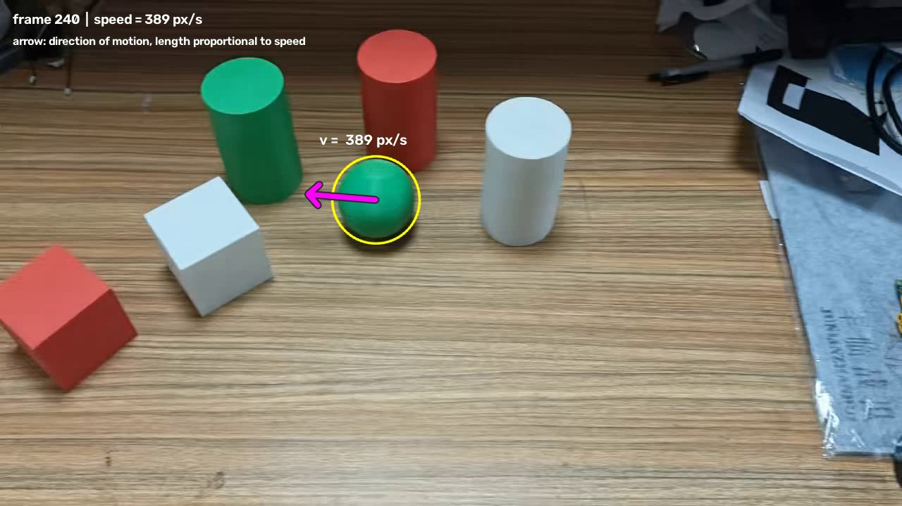
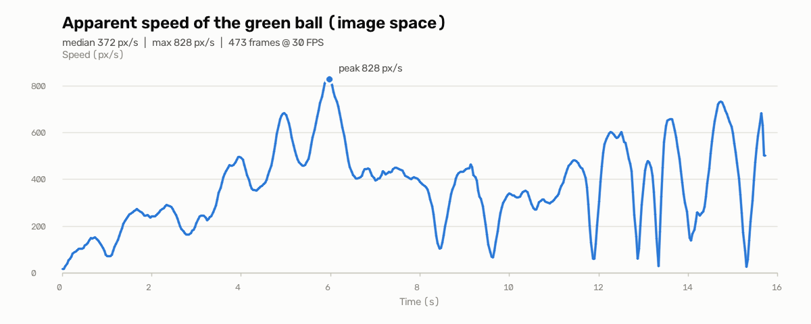

# 绿球检测与运动箭头标注

JLCV 自瞄培训选拔作业：识别 `homework.mp4` 中的绿球，并用箭头标注其运动方向和速度变化。

- 箭头方向 = 小球在画面中的运动方向
- 箭头长度 ∝ 运动速度（越快越长）
- 球心同时用黄色圆圈标出，旁边显示实时速度数值



---

## 1. 运行方法

```bash
# 安装依赖（无桌面环境可用 opencv-python-headless）
pip install -r requirements.txt

# 在 homework/<name>/ 目录下运行
python3 green_ball_tracker.py

# 默认输入：仓库根目录的 homework.mp4
# 默认输出：本目录下的 green_ball_annotated.mp4
```

可选参数：

```bash
python3 green_ball_tracker.py \
    --input ../../homework.mp4 \
    --output result.mp4 \
    --arrow-scale 0.25 \
    --min-arrow 25 \
    --max-arrow 200
```

附加分析（相机运动验证）与速度曲线：

```bash
python3 camera_motion_check.py
python3 plot_speed.py        # 生成 speed_curve.png
```

环境：Python 3.10+、OpenCV、NumPy。本机实测 Python 3.12 + OpenCV 5.0 + NumPy 2.5，
处理 473 帧约 4 秒。

---

## 2. 算法流程

程序采用**两遍处理**：第一遍只做检测和跟踪，算出整段轨迹与速度；第二遍再读一次视频，
按预先算好的速度画箭头。这样速度可以使用前后帧的中心差分，既准确又没有因果滤波的延迟。

### 2.1 颜色分割：HSV 阈值

BGR 三个通道互相耦合，光照一变阈值就很难通用。转成 HSV 后，颜色（H）和亮度（V）
分离，绿色集中在 H≈60 附近：

```python
HSV_LOWER = [35, 70, 40]
HSV_UPPER = [95, 255, 255]
mask = cv2.inRange(hsv, HSV_LOWER, HSV_UPPER)
```

阈值放宽到 H∈[35,95]，是为了覆盖小球高光、阴影和不同白平衡下的绿色。

### 2.2 形态学去噪

5×5 核先开运算（腐蚀后膨胀）去掉零散噪点，再闭运算（膨胀后腐蚀）填补球面高光
在掩码里打出的小空洞。

### 2.3 轮廓筛选：区分绿球和绿圆柱

画面里有一个**颜色几乎一样的绿圆柱**，只用面积或颜色会误检。实测两者的形状特征：

| 目标 | 宽高比 bw/bh | 圆度 4πA/P² |
|---|---|---|
| 绿球 | 0.93 ~ 1.05 | 0.71 ~ 0.77 |
| 绿圆柱 | 0.60 ~ 0.87 | 0.61 ~ 0.70 |

因此构造形状得分：

```
shape_score = circularity - 1.5 * |aspect - 1.0|
```

球约为 0.7，圆柱约为 0.1~0.3。低于 `SHAPE_GATE=0.32` 的候选直接丢弃。

> 注意：不能用“面积/半径”区分。镜头拉近时球半径会从 59 px 涨到 92 px，
> 末段球面积（约 21000）和圆柱（约 24900）已经非常接近。

### 2.4 逐帧关联：锁定同一个球

每帧可能检出多个合格候选，用“预测位置 + 形状得分”选择：

```
pred = last_position + last_velocity          # 用上一帧趋势预测
cost = |candidate - pred| - 250 * shape_score
```

取 cost 最小的候选；若它相对上一帧跳变超过 220 px（本视频最大真实位移约 28 px/帧），
则退回“形状最像球”的候选，防止镜头快速运动时锁错目标。
本视频 473 帧中有效检测 **471 帧**，其余 2 帧沿用上一帧位置。

### 2.5 轨迹平滑

检测到的圆心会有 1~3 px 的抖动（高光、边缘、部分遮挡）。先做 5 帧中值滤波去掉
单帧跳变，再做 5 帧滑动平均抑制高频抖动。中值滤波放在前面，是因为它能干净地
剔除孤立异常点，而平均滤波会被异常点拉偏。

### 2.6 速度计算

设平滑后的球心为 `p_t`，帧率为 `fps`，用中心差分：

```
v_t = (p_{t+1} - p_{t-1}) * fps / 2
speed_t = |v_t|
```

中心差分比 `p_t - p_{t-1}` 更平滑，也没有单边差分的相位滞后。边界帧用相邻帧速度复制。

### 2.7 箭头映射

```
length = clip(speed * 0.25, 25, 200)   # 单位：像素
```

- 系数 0.25：本视频速度中位数 372 px/s → 箭头约 93 px，视觉大小合适；
- 下限 25 px：慢速时仍能看清方向（首帧速度只有 19 px/s）；
- 上限 200 px：最快 828 px/s 时箭头不会冲出画面。

箭头从球心出发，方向取单位速度向量；先画深色粗线再画品红色细线，保证在木纹、
绿色球和阴影上都有足够对比度。

---

## 3. 关键参数

| 参数 | 值 | 依据 |
|---|---|---|
| HSV 绿色范围 | H [35,95], S≥70, V≥40 | 覆盖高光/阴影下的绿色 |
| 最小轮廓面积 | 1200 px² | 球面积约 1 万，滤掉背景绿色噪点 |
| 形态学核 | 5×5 | 去噪与填洞的折中 |
| 形状门槛 | 0.32 | 球≈0.7，圆柱≈0.1~0.3 |
| 关联最大跳变 | 220 px | 实测最大 28 px/帧，留足余量 |
| 中值/平均窗口 | 5 / 5 | 抑制 1~3 px 抖动，不明显改变真实运动 |
| 箭头比例 | 0.25 px/(px/s) | 中位速度对应约 93 px |
| 箭头长度范围 | 25~200 px | 慢速可见、快速不出画 |

---

## 4. 实验结果

| 项目 | 结果 |
|---|---|
| 视频 | 1280×720，30 FPS，473 帧，15.77 s |
| 有效检测 | 471 / 473 帧 |
| 速度范围 | 19 ~ 828 px/s |
| 速度中位数 | 372 px/s |
| 处理耗时 | 约 4 s |

输出视频：`green_ball_annotated.mp4`（已加入 `.gitignore`，运行脚本即可重新生成）。



速度随时间变化明显：起步约 20 px/s，约 6 s 达到峰值 828 px/s，后半段在
50~700 px/s 之间反复波动。这正是相机运动速度变化在画面中的体现。

### 全帧自检

除了抽样看帧，还对全部 473 帧做了自动检查：

| 检查项 | 结果 |
|---|---|
| 球心落在绿色掩码内 | 473 / 473 帧 |
| 检测圆内绿色像素占比 | 平均 90.5%，最低 84.0% |
| 球心到最近圆柱候选距离 | 最小 2.81×球半径（从未接近误锁） |
| 箭头方向 vs 原始位移方向 | 中位偏差 1.4°，p90 5.5° |

方向偏差最大 60° 只出现在运动反向的转折帧，属于平滑滤波的正常滞后。

---

## 5. 附加分析：画面里的运动其实来自相机

做题时发现：球在画面里到处移动，但**它相对桌面上的圆柱、方块几乎不动**。
为了确认不是跟踪错误，写了 `camera_motion_check.py` 做两个独立验证：

### 验证一：球 vs 静止绿圆柱

绿圆柱在桌面上显然不会动。比较两者相邻帧的位移矢量：

| 指标 | 结果 |
|---|---|
| 球平均位移 | 12.80 px/帧 |
| 绿圆柱平均位移 | 12.86 px/帧 |
| 位移方向余弦（中位数） | **0.9901**（1.0 = 完全同向） |
| 位移大小比例（中位数） | **0.992**（1.0 = 完全同速） |
| 位移差中位数 | 2.82 px |

两者位移几乎完全相同，说明是**整个场景相对相机在动**，球没有独立运动。

### 验证二：累积单应变换

用 ORB 特征匹配估计相邻帧单应矩阵并累积，把球心映射回第 0 帧坐标系：

| 指标 | 结果 |
|---|---|
| 参考坐标系下球心范围 | x [636,675]，y [361,418] px |
| 矫正后逐帧位移中位数 | **1.08 px** |
| 矫正后 p90 | 3.13 px |

补偿相机运动后球心基本不动，结论一致。

### 为什么仍然按“画面视运动”标注

作业要求的是“视频中小球的运动方向和速度变化”。视频里小球在画面上确实产生
连续位移，箭头需要反映这一观感；如果按桌面真实运动画，箭头长度会接近 0，
无法体现“速度变化”。因此：

- **主输出按图像坐标系的视运动计算速度和箭头**（符合题面与观感）；
- 同时在 README 中记录相机运动分析，明确区分“目标自身运动”和“相机造成的视运动”。

这也对应 RoboMaster 自瞄中的一个实际问题：云台/相机自身运动会让目标在图像中
产生额外速度，做运动预测或滤波时需要把两者分开。

---

## 6. 局限与可改进方向

1. **HSV 阈值依赖光照**：换场地/灯光后需要重新标定。可改用自适应阈值，或在
   Lab 空间分割，或加入基于深度学习的检测。
2. **多目标歧义**：若画面里出现多个相似绿球，最近邻关联可能跳目标。可加入
   Kalman 滤波和外观特征（颜色直方图）做数据关联。
3. **世界坐标速度**：当前主程序只输出图像视速度。若需要目标相对桌面的真实速度，
   可在求导前先用单应变换把球心映射到参考坐标系（`camera_motion_check.py`
   已验证该思路可行）。
4. **遮挡处理**：目前短暂丢失时沿用上一帧位置。更完整的做法是维护一个
   Kalman 预测器，并按预测置信度衰减箭头。
5. **箭头比例**：使用线性映射 + 上下限；若希望不同视频间可比，可改为按该视频
   速度分位数自适应缩放。

---

## 7. 文件说明

```
green_ball_tracker.py     # 主程序：检测、跟踪、平滑、速度估计、箭头绘制
camera_motion_check.py    # 附加分析：验证视运动来自相机移动
plot_speed.py             # 绘制速度-时间曲线
requirements.txt          # 依赖
preview.jpg               # 标注效果预览图
speed_curve.png           # 速度曲线图
README.md                 # 本文档
green_ball_annotated.mp4  # 运行生成的结果视频（未入库）
```
