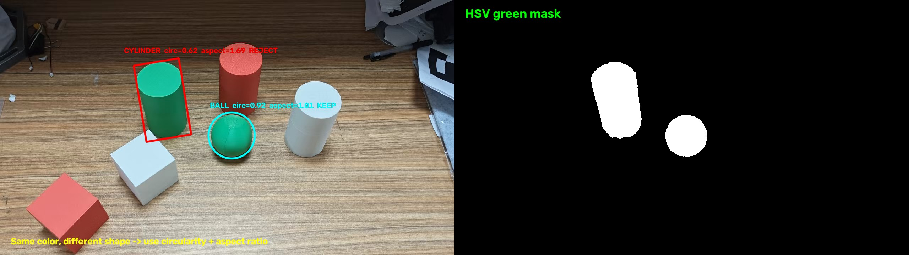
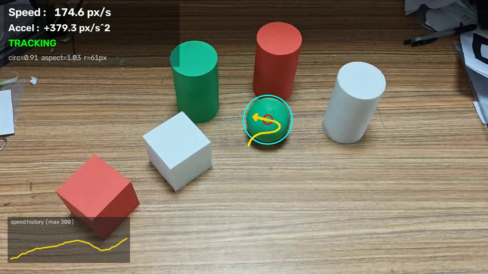
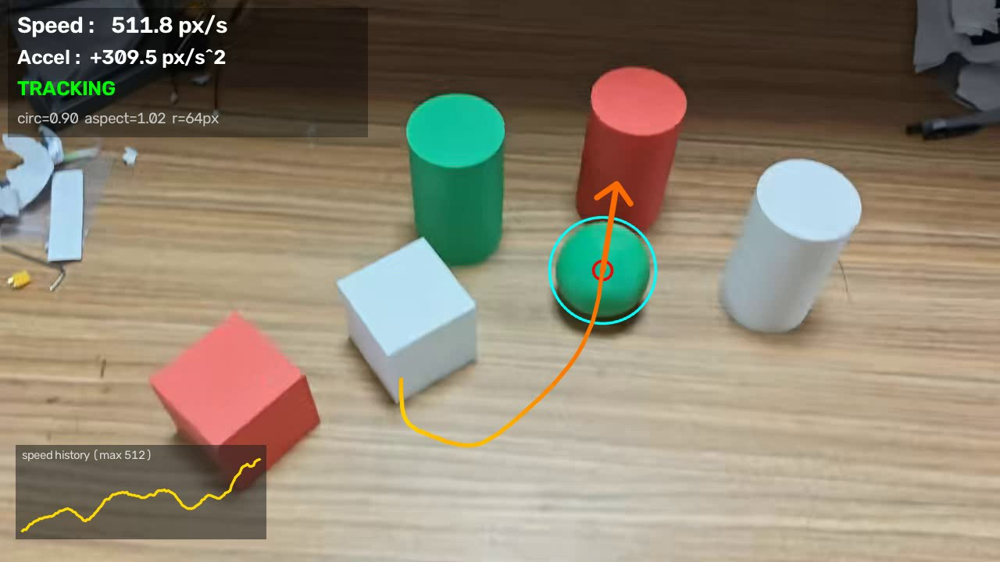
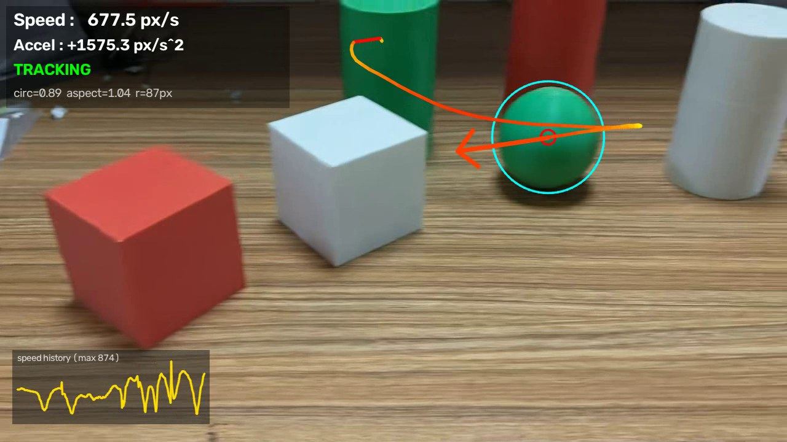

# 绿球识别与运动方向 / 速度标注

> NUDT 自瞄培训 · week-opencv 作业  
> 作者：宋禹辰  
> 代码：`homework/songyuchen/green_ball_tracker.py`

## 1. 作业要求与实现效果

**作业要求**：识别视频中的绿球，并使用箭头标注其运动方向和速度变化。

**实现效果**：

- 箭头方向 = 绿球在当前画面中的运动方向；
- 箭头长度 ∝ 速度大小，速度快时箭头长、速度慢时箭头短；
- 箭头颜色随速度由黄变红，左下角同时画出速度-时间曲线；
- 轨迹线保留最近若干帧的球心位置，能直接看出球的运动路径；
- 桌面上的**绿色圆柱**会被形态学判据筛掉，不会被当成球。

### 1.1 关键点：如何区分绿球和绿色圆柱

只按颜色分割时，绿球和绿色圆柱都会进入掩膜。两者的区别在**形状**：

- 绿球是球体，投影接近正圆；
- 绿色圆柱的侧面投影是圆角矩形，最小外接矩形长宽比明显大于 1。

因此程序同时使用两个形状特征：

```
圆度 circularity = 轮廓面积 / 最小外接圆面积
长宽比 aspect    = 最小外接矩形长边 / 短边
```

实测数据：

| 目标 | 圆度范围 | 长宽比范围 | 处理方式 |
|---|---|---|---|
| 绿球 | 0.86 ~ 0.94 | ≈ 1.00 ~ 1.05 | 保留 |
| 绿色圆柱 | 0.45 ~ 0.72 | 1.39 ~ 1.78 | 剔除 |

本作业取 `圆度 ≥ 0.80` 且 `长宽比 ≤ 1.30`，两者之间有足够裕量。



左图：青色圆圈标出绿球（保留），红色框标出绿色圆柱（剔除）；  
右图：HSV 绿色掩膜，可以看到两者的颜色几乎一样，**只靠颜色无法区分**。

### 1.2 标注效果







左上角显示当前速度、加速度和跟踪状态；左下角是最近一段时间的速度曲线。

## 2. 运行方法（Ubuntu）

### 2.1 安装依赖

方式一：直接用系统包（推荐，最省事）：

```bash
sudo apt update
sudo apt install -y python3 python3-opencv python3-numpy
```

方式二：虚拟环境 + pip：

```bash
python3 -m venv .venv
source .venv/bin/activate
pip install -r requirements.txt
```

验证：

```bash
python3 -c "import cv2, numpy; print(cv2.__version__, numpy.__version__)"
```

### 2.2 运行

脚本默认会向上找到仓库根目录的 `homework.mp4`，所以通常不需要写视频路径：

```bash
cd homework/songyuchen

# 弹窗播放（按 q 或 ESC 退出）
python3 green_ball_tracker.py

# 无显示器 / SSH 环境：只生成结果视频
python3 green_ball_tracker.py --headless --output result.mp4

# 同时导出逐帧轨迹 CSV，方便核对检出率
python3 green_ball_tracker.py --headless --output result.mp4 --csv track.csv
```

如果视频不在默认位置，用 `--video /path/to/video.mp4` 指定。

> `result.mp4`、`track.csv` 是运行产物，已写入 `.gitignore`，不提交到仓库。

### 2.3 参数说明

| 参数 | 作用 |
|---|---|
| `--video PATH` | 输入视频，默认仓库根目录的 `homework.mp4` |
| `--output PATH` | 输出标注后的视频，例如 `result.mp4` |
| `--csv PATH` | 导出逐帧 `frame, x, y, vx, vy, speed, accel, radius, area, circularity, detected` |
| `--headless` | 不打开窗口，适合 SSH / 无显示器环境 |
| `--show-mask` | 右上角显示绿色掩膜小窗，调阈值时用 |
| `--scale 0.75` | 显示窗口缩放比例（小屏笔记本用） |
| `--trail 45` | 轨迹保留帧数 |

## 3. 算法流程

```
读帧
  │
  ├─ BGR → HSV，绿色阈值分割
  │
  ├─ 形态学开运算（去噪点）+ 闭运算（补高光小洞）
  │
  ├─ findContours 找轮廓
  │
  ├─ 面积 + 圆度 + 长宽比三重筛选  ← 去掉绿色圆柱和噪点
  │
  ├─ 连续性选择：在候选中选离“上一帧预测位置”最近的
  │
  ├─ 速度估计：v = Δ球心 × fps，再做指数平滑
  │
  └─ 画箭头 / 轨迹 / 速度曲线 / HUD
```

### 3.1 HSV 颜色分割

HSV 把“颜色（H）”和“亮度（V）”分开。桌面的高光、阴影主要改变 V，几乎不改变 H，所以比直接在 BGR 空间设阈值稳定。

```python
GREEN_LOWER = np.array([35, 60, 50])    # OpenCV 的 H 范围是 0~179，纯绿 H≈60
GREEN_UPPER = np.array([90, 255, 255])  # 上下放宽，兼容球面明暗过渡
```

### 3.2 形态学处理

- **开运算**（先腐蚀后膨胀，5×5 椭圆核）：去掉桌面上零星的绿色噪点；
- **闭运算**（先膨胀后腐蚀）：补上球面高光造成的白色小洞，避免圆度被拉低。

使用椭圆结构元而不是矩形核，是因为椭圆更贴合球体边缘。

### 3.3 形状筛选（本作业的关键）

对每个轮廓：

```python
area = cv2.contourArea(contour)
(_, _), radius = cv2.minEnclosingCircle(contour)
circularity = area / (np.pi * radius * radius)

(_, _), (w, h), _ = cv2.minAreaRect(contour)
aspect_ratio = max(w, h) / min(w, h)

if circularity < 0.80 or aspect_ratio > 1.30:
    continue          # 不是球
```

**为什么不能“取绿色面积最大的区域”？**  
绿色圆柱通常比绿球更大，按面积取最大会把圆柱选中。颜色相同的情况下，只能靠形状区分：

- 圆度：球接近 1，圆柱侧面接近矩形，圆度明显更低；
- 长宽比：球接近 1，圆柱侧面长宽比大于 1。

两个条件同时使用，比只用其中一个更稳。

### 3.4 连续性选择

画面里可能同时出现多个通过筛选的绿色区域（例如球被部分遮挡、或者圆柱顶面恰好接近圆形）。程序用匀速模型预测球在下一帧的位置：

```python
predicted = center + velocity
score = circularity + 0.8 * max(0, 1 - distance_to_predicted / 300)
```

综合“像不像球”和“离预测位置近不近”打分，避免箭头在物体之间乱跳。

### 3.5 速度估计与平滑

```python
raw_velocity = new_center - old_center       # 像素/帧
velocity = 0.55 * raw_velocity + 0.45 * old_velocity
speed = np.linalg.norm(velocity) * fps       # 像素/秒
```

- 用指数平滑是因为球面高光会让质心有 1~2 像素抖动，不平滑的话箭头方向会一直晃；
- 单位用 **px/s** 而不是 m/s：单目相机没有标定，像素和真实米数的比例未知，直接写 m/s 反而是错的；
- 加速度 `a = d|v|/dt` 只用于左上角显示，也做了平滑。

### 3.6 箭头长度与颜色

```python
arrow_length = clip(speed * 0.22, 30, 260)   # 像素
```

- 箭头方向 = 速度方向；
- 箭头越长，速度越快；
- 颜色按 `speed / 900` 从黄色渐变到红色。

最短 30 像素是为了低速时也能看清方向，最长 260 像素是为了避免箭头冲出画面。

### 3.7 丢失处理

如果某一帧没有找到合格候选（例如球被物体挡住、或球被画面边缘裁掉），程序会用预测位置续接，最多 10 帧：

- 这 10 帧内状态显示 `PREDICTING`，**不画速度箭头**（因为速度是旧值，画出来会误导）；
- 超过 10 帧仍找不到，就清空状态，等待重新捕获。

## 4. 实验结果

测试视频：仓库根目录 `homework.mp4`，1280×720，30 fps，共 **473 帧**（约 15.8 秒）。

| 指标 | 结果 |
|---|---|
| 检出帧数 | **462 / 473 = 97.7%** |
| 漏检帧 | 355、357~359、422~428（共 11 帧） |
| 误把圆柱当球 | 0 帧 |
| 速度均值 | 378.0 px/s |
| 速度中位数 | 379.3 px/s |
| 速度最大值 | 873.5 px/s |

**关于漏检的 11 帧**：这些帧里绿球正好被画面的上边缘或下边缘裁掉一部分，轮廓不再是完整圆形，圆度降到阈值以下。程序此时进入 `PREDICTING` 状态，用预测位置续接，球重新完整出现在画面后立刻恢复跟踪。这是单目 2D 检测的边界情况，不是把圆柱误判成球。

## 5. 讨论

### 5.1 画面里的速度 ≠ 球真实速度

这段视频是手持相机拍摄的，球本身基本静止在桌上，画面里看到的“移动”主要来自相机运动。因此箭头表示的是**球在图像坐标系里的速度**，也就是“球在画面中往哪个方向偏、偏得多快”。

这对自瞄/雷达是有意义的：云台相机就是系统的“眼睛”，控制器需要知道目标在图像里往哪走。若要得到球相对桌面的真实运动，需要额外做相机运动补偿（光流 + 单应/仿射变换），这是本作业之外的扩展方向。

### 5.2 与“识别绿色最多的部分”的区别

绿色圆柱的面积通常大于绿球，如果按“最大绿色区域”选目标，会稳定地选到圆柱。本程序先用颜色得到候选，再用**圆度 + 长宽比**做形状判断，最后用连续性防止跳变，所以框住的始终是球。

### 5.3 局限

| 局限 | 说明 | 改进方向 |
|---|---|---|
| 边界裁切会漏检 | 球被画面边缘裁掉一部分时圆度下降 | 对贴近边界的轮廓放宽圆度阈值；或用霍夫圆检测 |
| HSV 阈值固定 | 强光、阴影、换球后会偏色 | 加白平衡/自适应阈值，或改用 YOLO 等学习方法 |
| 单目无绝对尺度 | 只能得到 px/s，不能得到 m/s | 相机标定 + 已知球直径反算深度 |
| 相似变换未做 | 相机运动被计入球的速度 | 光流 + RANSAC 估计背景运动并补偿 |

## 6. AI 工具使用说明

按要求注明：

- **使用的 AI 工具**：Claude Code（AI 编程助手）。
- **使用范围**：代码骨架与中文注释初稿、HSV/圆度等参数初值建议、README 初稿。
- **验证情况**：代码已在本机 Ubuntu 上对 `homework.mp4` 完整跑过，473 帧检出 462 帧；所有参数和统计结果都是实际运行得到的，不是照抄。
- 面试前需要提交者逐行阅读并理解检测、筛选、跟踪、速度估计和可视化的实现，能够独立讲解。

## 7. 面试讲解提纲

被要求“讲讲你的代码”时，可以按这个顺序讲（约 3 分钟）：

1. **一句话概括**：HSV 分割出绿色区域 → 用圆度 + 长宽比把绿球和绿色圆柱分开 → 连续性跟踪 → 用箭头长度和颜色表示速度及速度变化。
2. **最容易被追问的点：场上有绿色圆柱怎么办？**  
   只靠颜色会一起框进来；我加了圆度（面积 / 最小外接圆面积）和长宽比两个形状判据，实测球圆度 0.86~0.94、圆柱 0.45~0.72，阈值取 0.80 就能分开。
3. **为什么不用“最大绿色区域”？**  
   圆柱通常比球大，按面积取最大必然选错；必须靠形状。
4. **速度怎么算？**  
   相邻两帧球心位移 × fps，得到 px/s；再做指数平滑，避免高光导致箭头抖动。
5. **箭头怎么表示速度变化？**  
   长度 `clip(speed × 0.22, 30, 260)`，颜色按速度从黄到红；左下角速度曲线直接展示变化趋势。
6. **丢了怎么办？**  
   匀速模型预测，最多续接 10 帧；预测状态不画箭头，避免误导。
7. **局限**：边界裁切、HSV 固定、单目无尺度、相机运动未补偿。

## 8. 文件说明

```
homework/songyuchen/
├── green_ball_tracker.py   # 主程序（检测 + 跟踪 + 可视化）
├── README.md               # 本文档
├── requirements.txt        # Python 依赖
├── .gitignore              # 忽略结果视频、CSV、缓存等运行产物
└── docs/
    ├── ball_vs_cylinder.jpg  # 球 vs 圆柱的形状对比
    ├── result_frame_40.jpg   # 标注效果
    ├── result_frame_120.jpg
    └── result_frame_470.jpg
```
