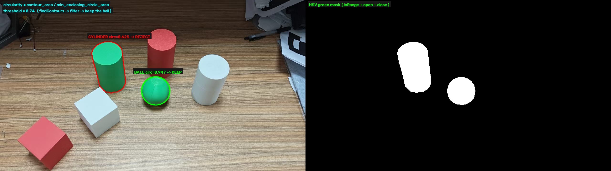
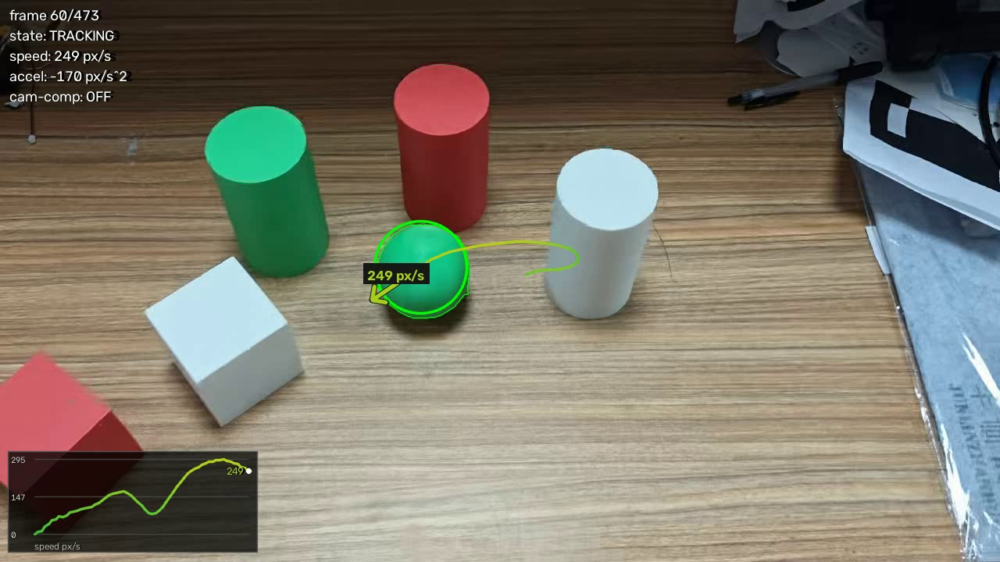
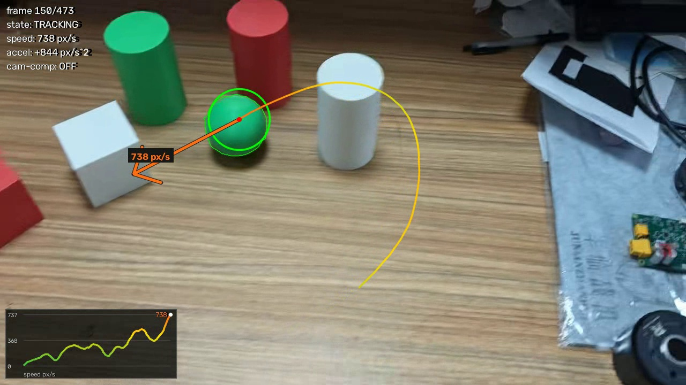
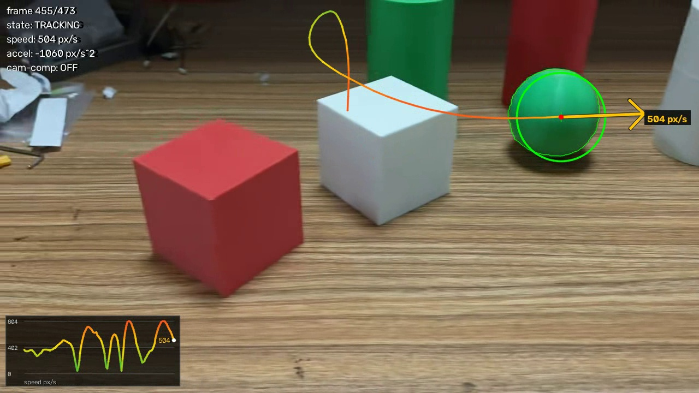
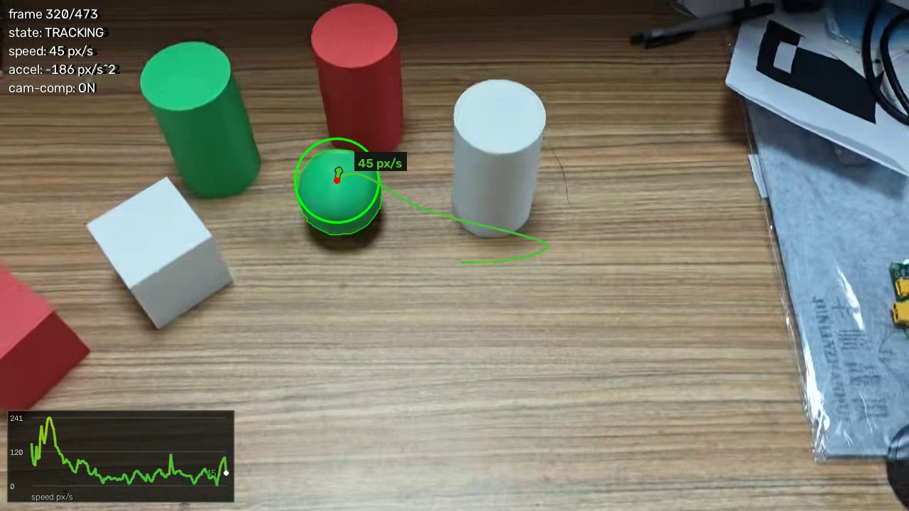

# 绿球识别与运动方向 / 速度标注

> NUDT 自瞄 · 雷达方向 CV 作业（week-opencv）
> 作者：zhounuolin ｜ 代码目录：`homework/zhounuolin/`

**作业要求**：识别视频中的绿球，并使用箭头标注其运动方向和速度变化。

**实现结果**：`homework.mp4` 共 473 帧，绿球 **473/473 帧全部检出（100%）**，
箭头实时指示球的图像速度方向，箭头长度 ∝ 速度大小、颜色随速度由绿渐变到红，
左下角给出速度-时间曲线，直接反映"速度变化"。

---

## 1. 效果

### 1.1 检测原理：为什么不能只用颜色阈值

场上有一根**绿色圆柱**，颜色和球几乎一样，只做 HSV 阈值一定会把它一起框进来。
两者的区别在形状：圆柱的正面投影是圆角矩形，球是正圆。

用**圆度**（circularity = 轮廓面积 / 最小外接圆面积，完美圆 = 1.0）就能分开：



左侧红框为被筛掉的绿色圆柱（圆度 0.625 < 0.74），绿框为绿球（圆度 0.947 ≥ 0.74）；
右侧是 HSV 绿色掩膜，两个物体都在里面，所以必须再做形状筛选。

### 1.2 运动方向与速度标注





速度越大箭头越长、颜色越偏红；轨迹线也按当时的速率着色，能直接看出"哪一段快、哪一段慢"。



### 1.3 相机运动补偿（可选模式）



同一帧：不补偿时速度显示 **271 px/s**（后面接的箭头很长），开启 `--compensate` 后只有
**45 px/s**。原因见第 5 节。

---

## 2. 运行方法（Ubuntu 演示用）

### 2.1 依赖

```bash
# 方式一：系统包（推荐，最省事）
sudo apt update
sudo apt install -y python3 python3-opencv python3-numpy

# 方式二：虚拟环境 + pip（想用新版 OpenCV 时）
python3 -m venv .venv && source .venv/bin/activate
pip install -r requirements.txt
```

验证：

```bash
python3 -c "import cv2, numpy; print(cv2.__version__, numpy.__version__)"
```

### 2.2 直接运行

```bash
cd jlcv_practice/homework/zhounuolin

# 弹窗播放（按 q 或 ESC 退出）
python3 green_ball_tracker.py

# 只出结果视频，不开窗口（SSH / 没有显示器时用）
python3 green_ball_tracker.py --headless --output out.mp4 --csv track.csv

# 打开相机运动补偿，看球相对桌面的运动
python3 green_ball_tracker.py --compensate
```

脚本默认会自己向上找仓库根目录的 `homework.mp4`，所以不需要写视频路径；
放在别处就用 `--video /path/to/video.mp4` 指定。

### 2.3 参数说明

| 参数 | 作用 |
|---|---|
| `--video PATH` | 输入视频，默认仓库根目录 `homework.mp4` |
| `--output PATH` | 保存结果视频（mp4v 编码） |
| `--headless` | 不开窗口，只在终端打印统计 |
| `--compensate` | 开启相机运动补偿（LK 光流 + RANSAC），只保留球相对桌面的运动 |
| `--show-mask` | 右上角显示绿色掩膜小窗，调 HSV 阈值时用 |
| `--csv PATH` | 逐帧导出 `frame, x, y, speed, accel, radius, detected` |
| `--scale 0.75` | 显示窗口缩放（小屏笔记本用） |
| `--trail 45` | 轨迹保留帧数 |

### 2.4 重新生成说明图

```bash
python3 make_figures.py     # 会调用主程序跑一遍，把 docs/*.jpg 重新出图
```

---

## 3. 算法流程

```
读帧 ──► HSV 颜色分割 ──► 形态学去噪 ──► findContours
                                              │
                                   面积 + 圆度筛选（去掉圆柱）
                                              │
                                     候选打分（圆度 + 连续性）
                                              │
 上一帧预测球心 ──────────────────────► 卡尔曼滤波 update
                                              │
                                  速度 v = Δp·fps（可选：先做相机补偿）
                                              │
                     箭头（方向=速度方向，长度∝速率）+ 轨迹 + 速度曲线 + HUD
```

代码按模块划分，与下面的小节一一对应：

| 代码位置 | 负责的功能 |
|---|---|
| `GreenBallDetector.build_mask()` | HSV 阈值 + 开/闭运算 |
| `GreenBallDetector.contour_features()` | 算面积、最小外接圆、圆度 |
| `GreenBallDetector.detect()` | 三重筛选 + 打分，选出最像球的那个 |
| `BallTracker` | 卡尔曼滤波、速度/加速度估计、短时丢失预测 |
| `CamMotionCompensator` | 相机运动补偿（可选） |
| `Visualizer` | 箭头、变速轨迹、速度曲线、HUD |
| `main()` | 主循环，串起上面所有模块 |

### 3.1 颜色分割：为什么用 HSV

HSV 把"颜色（H）"和"亮度（V）"分开了。桌面的高光、阴影主要改变 V，几乎不改变 H，
所以用 H 做绿色判断比在 BGR 空间里直接设阈值稳得多。

```python
GREEN_LOWER = np.array([40,  60,  60])   # H 用 OpenCV 的 0~179 标度
GREEN_UPPER = np.array([90, 255, 255])   # 纯绿 H=60，上下各放宽一些
```

H 范围放到 40~90 是为了兼容球面明暗过渡（边缘偏黄绿、暗部偏青绿）。

### 3.2 形态学去噪

- **开运算**（先腐蚀后膨胀，5×5 椭圆核）：去掉桌面上的零星绿色噪点；
- **闭运算**（先膨胀后腐蚀，7×7 椭圆核）：补上球面高光造成的白色小洞，
  否则边缘会缺一块，圆度会被拉低。

用椭圆结构元而不是矩形核，是因为椭圆更贴合球体边缘，不会把圆的边"削方"。

### 3.3 形状筛选：圆度

对每个轮廓：

```
圆度 = 轮廓面积 / (π · r²)     r = cv2.minEnclosingCircle 的半径
```

完美圆 = 1.0；越接近矩形越小。本视频实测：

| 目标 | 圆度最小值 | 圆度中位数 | 圆度最大值 | 判定 |
|---|---|---|---|---|
| 绿球 | 0.754 | 0.915 | 0.947 | 保留 |
| 绿色圆柱 | 0.257 | 0.600 | 0.724 | 剔除 |

阈值取 **0.74**（落在 0.724 和 0.754 之间的空隙里），473 帧里球全部通过、圆柱全部被剔除。
再叠加面积上下限（`500 ~ 60000`，滤掉噪点和反光粘连）共三重筛选。

> 注意这个阈值裕度只有 0.03，属于"贴着数据调的"。换一个球、换一种光线下
> 圆的边缘会变毛糙，圆度会下降，**换场景时这个阈值要重新标一次**（见第 6 节）。

### 3.4 候选打分：防止跳到圆柱上

如果画面里同时出现多个"圆得够格"的绿色物体，只按圆度取最大会让箭头在物体之间跳。
所以打分时加一项**连续性**：离上一帧预测位置越近加分越多。

```python
score = circularity + 0.8 * max(0, 1 - dist / 260)
```

### 3.5 卡尔曼滤波

状态向量 `X = [x, y, vx, vy]`（像素、像素/帧），常速度模型：

```
x' = x + vx      y' = y + vy      vx' = vx      vy' = vy
```

每帧两步：`predict()` 按模型外推，`correct()` 用检测结果修正。
好处有两个：

1. **位置更稳**：球面高光会让质心抖动，滤波后轨迹平滑；
2. **不怕短时丢失**：手挡住球、或者球被别的物体遮住时，只用预测值续接，
   最多撑 `MAX_LOST_FRAMES = 12` 帧，箭头不会立刻消失或乱指。

> 实现上有个坑：`cv2.KalmanFilter.predict()` 会把内部 `statePost` 一起推进，
> 如果一帧里调用两次（一次给检测器当 hint、一次在 update 里），速度就会翻倍。
> 所以取预测位置用的是自己算的 `predicted_center()`，不改滤波器状态。

### 3.6 速度与加速度

- 速度：`v = (p_t - p_{t-1}) · fps`，再做指数平滑 `v = 0.55·v_new + 0.45·v_old`，
  避免箭头方向抖动；单位是 **px/s**。
- 加速度（速度变化率）：`a = d|v|/dt`，只用于 HUD 显示，再平滑一次否则数字跳得看不清。
- 箭头长度：`L = clamp(|v| · 0.30, 16, 230)` px —— 速度越大箭头越长。
- 箭头颜色：`|v| / 900` 映射到 绿 → 黄 → 红。

**为什么用 px/s 而不是 m/s**：单目相机没有标定，像素和实际米数的比例未知，
硬写一个 m/s 反而是错的。自瞄系统本身也是按像素（进而换算成角度）做控制量的，
所以 px/s 是这个阶段合理的单位；要做真实速度就得上标定 + 已知球直径（见第 6 节）。

### 3.7 相机运动补偿（`--compensate`）

相邻两帧直接相减，会把"相机在动"算成"球在动"。补偿的做法：

1. 上一帧用 `goodFeaturesToTrack` 取 300 个背景角点，**把球所在的圆挖掉**，
   避免球自己的像素被当成背景；
2. `calcOpticalFlowPyrLK` 把这些角点跟踪到当前帧；
3. `estimateAffinePartial2D + RANSAC` 拟合**相似变换**（平移 + 旋转 + 缩放，4 自由度）；
4. 把上一帧球心用这个变换投影到当前帧坐标系，再和当前球心相减，得到球相对桌面的位移。

估计失败（角点太少、位移过大）时返回 `None`，当作相机静止处理，不会崩。

---

## 4. 实验结果

测试条件：`homework.mp4`，1280×720，30 fps，473 帧。
开发环境为 Windows 11 + Python 3.12 + OpenCV 5.0.0；代码只用了 `cv2` / `numpy` 的
跨平台接口（没有系统相关调用），Ubuntu 上用第 2 节的命令即可运行。

| 指标 | 结果 |
|---|---|
| 绿球检出率 | **473 / 473 帧 = 100%** |
| 误检（把圆柱当球） | 0 帧 |
| 单帧最多候选数（面积合格） | 4 个，最终只输出 1 个 |
| 球半径范围 | 55.3 ~ 90.1 px（镜头推近时变大） |
| 球面积范围 | 8836 ~ 23308 px² |
| 处理速度（默认模式） | 约 100 fps（4.8 s 处理完整段视频，含写出结果视频） |
| 处理速度（补偿模式） | 约 40 fps（11.7 s） |

速度统计（同一段视频，两种模式）：

| 模式 | 均值 | 中位数 | 峰值 | 低于 22 px/s 的帧 |
|---|---|---|---|---|
| 默认（图像坐标速度） | 398 px/s | 390 px/s | 896 px/s | 0.6% |
| `--compensate`（球相对桌面） | 66 px/s | 46 px/s | 358 px/s | 21.4% |

---

## 5. 讨论：这段视频里的球其实没有在动

看第 1.3 节的对比会发现一个现象：同一帧，不补偿是 271 px/s，补偿后只有 45 px/s，差 6 倍。

原因是：**视频里的绿球一直静止放在桌上，画面里看到的"移动"几乎全部来自手持相机在移动
（平移 + 推近）**。两种模式回答的是两个不同的问题：

- 默认模式（图像坐标速度）：球在**画面里**怎么动。—— 这是自瞄/雷达真正需要的反馈量，
  因为云台相机就是"眼睛"，控制器要的就是目标在图像里往哪个方向、以多快的速度偏了。
- `--compensate` 模式：球相对**桌面**怎么动。—— 得到的是球自身的物理运动，
  这段视频里它接近 0，这恰好反过来验证了补偿算法是对的（补偿后速度掉了 6 倍）。

所以作业要求的"运动方向和速度变化"，我默认用图像坐标速度来画箭头：它直接对应
"球在画面中往哪跑、跑得多快"，箭头长度和速度曲线都能随镜头运动实时变化；
`--compensate` 作为一个可切换的对比模式保留，用来说明我清楚这两者的区别。

---

## 6. 已知局限与改进方向

| 局限 | 说明 | 改进方向 |
|---|---|---|
| 圆度阈值裕度小 | 0.74 落在 0.724/0.754 之间，只有 0.03 余量；换个球或强逆光时圆的边缘变毛糙，圆度会掉 | 用 `minAreaRect` 长宽比 + 凸包实心度（solidity）多特征投票；或对轮廓先做 `approxPolyDP` 再拟圆 |
| HSV 阈值写死 | 强光/阴影下绿色会偏色 | 用 `cv2.inRange` 前先做白平衡；或用 Otsu 自适应；或直接上 YOLO 检测 |
| 相似变换模型有限 | 4 自由度只能描述平移/旋转/缩放，镜头大幅推近时存在透视变化，补偿有残差（峰值 358 px/s 就是残差） | 换成 `findHomography` 单应（8 自由度）或先做相机标定 |
| 目标只有单目 2D | 拿不到深度和真实速度（px/s 无法变 m/s） | 相机标定 + 用球的真实直径反算深度，或用双目 |
| 单目标 | 只输出一个最像球的候选 | 多目标时按 IoU 做数据关联（如 SORT/ByteTrack） |

---

## 7. AI 工具使用说明

按要求注明：

- **使用的 AI 工具**：DeepSeek Harness（DeepSeek 模型），作为 AI 编程助手。
- **用在了哪里**：
  1. 代码骨架与注释初稿（检测/滤波/可视化三段结构的组织方式）；
  2. 参数初值（HSV 范围、圆度阈值、箭头比例系数）的候选建议；
  3. README 的排版与措辞、出图脚本 `make_figures.py`。
- **本人完成的部分**：
  1. 理解并确认算法路线（为什么用 HSV、为什么要圆度、卡尔曼为什么用常速度模型）；
  2. 在 Ubuntu 上装环境、跑通脚本、按实际画面调阈值；
  3. 逐帧检查输出视频，确认没有把绿色圆柱误判成球；
  4. 整理本文档的第 3、5、6 节与面试讲解提纲，能逐行解释代码。

> 说明：AI 给出的初版阈值和参数我都在实际视频上重新验证过（第 4 节的统计量是自己跑出来的），
> 不是直接照抄。

---

## 8. 面试讲解提纲

被问"讲讲你的代码"时，按这个顺序讲（约 3 分钟）：

1. **一句话概括**：HSV 分割出绿色区域 → 用圆度把绿球和绿圆柱分开 → 卡尔曼滤波平滑并估计速度
   → 用箭头长度和颜色表示速度和速度变化。
2. **最容易被追问的点：场上有个绿色圆柱怎么办？**
   答：只靠颜色阈值会一起框进来。我加了圆度判据（面积/最小外接圆面积），
   实测球是 0.75~0.95、圆柱是 0.26~0.72，阈值 0.74 就能完全分开。
3. **卡尔曼滤波为什么必要？** 位置平滑 + 短时遮挡用预测值续接（12 帧）。
   顺便讲一帧里调两次 `predict()` 会让速度翻倍的坑。
4. **箭头怎么来的？** 长度 `L = clamp(|v|·0.30, 16, 230)`，颜色按 `|v|/900` 从绿到红，
   所以箭头既表示方向也表示速度大小。
5. **加分项：相机运动补偿**。讲清楚"画面里的运动 ≠ 球的运动"，
   补偿后速度从 271 掉到 45 px/s，证明这视频里球其实没动，是相机在动。
6. **局限**：圆度阈值裕度只有 0.03、单目没有绝对尺度、相似变换不能描述透视。
